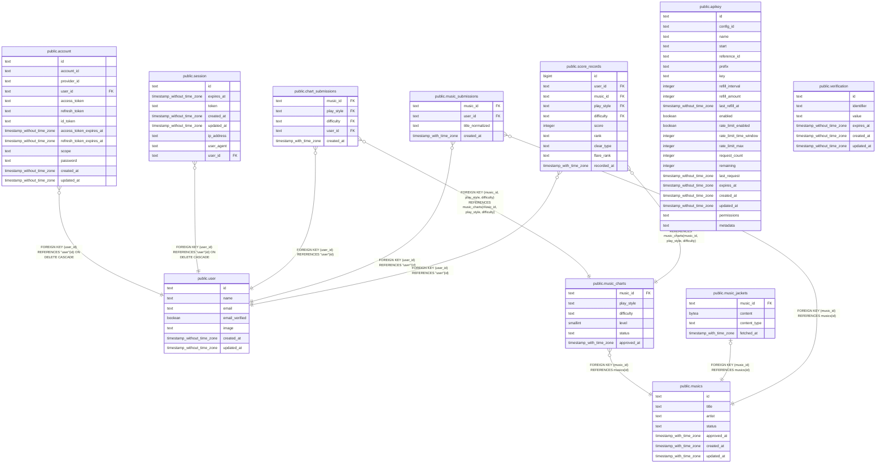

# ddr-score-manager server

## Tables

| Name                                                    | Columns | Comment                                              | Type       |
| ------------------------------------------------------- | ------- | ---------------------------------------------------- | ---------- |
| [public.account](public.account.md)                     | 13      | Better Auth が管理する外部認証アカウントと認証情報。 | BASE TABLE |
| [public.apikey](public.apikey.md)                       | 22      | Better Auth API key plugin が管理する API キー。     | BASE TABLE |
| [public.session](public.session.md)                     | 8       | Better Auth が管理するログインセッション。           | BASE TABLE |
| [public.user](public.user.md)                           | 7       | Better Auth が管理する認証ユーザー。                 | BASE TABLE |
| [public.verification](public.verification.md)           | 6       | Better Auth の検証処理で使う値と有効期限。           | BASE TABLE |
| [public.chart_submissions](public.chart_submissions.md) | 5       | 未承認の譜面に対するユーザーごとの登録記録。         | BASE TABLE |
| [public.music_charts](public.music_charts.md)           | 6       | 楽曲ごとのプレイスタイル・難易度別譜面と承認状態。   | BASE TABLE |
| [public.music_jackets](public.music_jackets.md)         | 4       | 楽曲に紐づくジャケット画像データ。                   | BASE TABLE |
| [public.music_submissions](public.music_submissions.md) | 4       | 楽曲ごとにユーザーが行った登録内容の記録。           | BASE TABLE |
| [public.musics](public.musics.md)                       | 7       | DDR 楽曲のカタログと承認状態。                       | BASE TABLE |
| [public.score_records](public.score_records.md)         | 10      | ユーザーが登録した譜面ごとのスコア記録。             | BASE TABLE |

## Relations

---

> Generated by [tbls](https://github.com/k1LoW/tbls)
