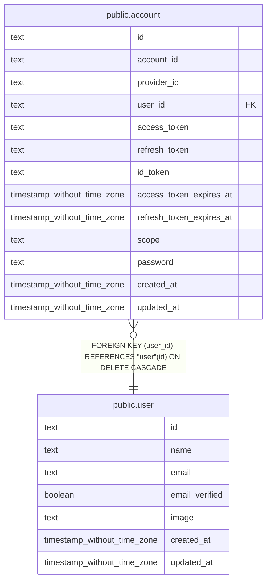

# public.account

## Description

Better Auth が管理する外部認証アカウントと認証情報。

## Columns

| Name                     | Type                        | Default | Nullable | Children | Parents                       | Comment                                      |
| ------------------------ | --------------------------- | ------- | -------- | -------- | ----------------------------- | -------------------------------------------- |
| id                       | text                        |         | false    |          |                               |                                              |
| account_id               | text                        |         | false    |          |                               | 認証プロバイダー内でアカウントを識別する値。 |
| provider_id              | text                        |         | false    |          |                               | 認証プロバイダーの識別子。                   |
| user_id                  | text                        |         | false    |          | [public.user](public.user.md) | この認証アカウントを所有するユーザー。       |
| access_token             | text                        |         | true     |          |                               | 認証プロバイダーのアクセストークン。         |
| refresh_token            | text                        |         | true     |          |                               | 認証プロバイダーのリフレッシュトークン。     |
| id_token                 | text                        |         | true     |          |                               | 認証プロバイダーの ID トークン。             |
| access_token_expires_at  | timestamp without time zone |         | true     |          |                               | アクセストークンの有効期限。                 |
| refresh_token_expires_at | timestamp without time zone |         | true     |          |                               | リフレッシュトークンの有効期限。             |
| scope                    | text                        |         | true     |          |                               | 認証時に要求した権限の範囲。                 |
| password                 | text                        |         | true     |          |                               | パスワード認証に使う値。                     |
| created_at               | timestamp without time zone | now()   | false    |          |                               |                                              |
| updated_at               | timestamp without time zone |         | false    |          |                               |                                              |

## Constraints

| Name                         | Type        | Definition                                                    |
| ---------------------------- | ----------- | ------------------------------------------------------------- |
| account_account_id_not_null  | n           | NOT NULL account_id                                           |
| account_created_at_not_null  | n           | NOT NULL created_at                                           |
| account_id_not_null          | n           | NOT NULL id                                                   |
| account_provider_id_not_null | n           | NOT NULL provider_id                                          |
| account_updated_at_not_null  | n           | NOT NULL updated_at                                           |
| account_user_id_not_null     | n           | NOT NULL user_id                                              |
| account_pkey                 | PRIMARY KEY | PRIMARY KEY (id)                                              |
| account_user_id_user_id_fk   | FOREIGN KEY | FOREIGN KEY (user_id) REFERENCES "user"(id) ON DELETE CASCADE |

## Indexes

| Name               | Definition                                                                |
| ------------------ | ------------------------------------------------------------------------- |
| account_pkey       | CREATE UNIQUE INDEX account_pkey ON public.account USING btree (id)       |
| account_userId_idx | CREATE INDEX "account_userId_idx" ON public.account USING btree (user_id) |

## Relations

---

> Generated by [tbls](https://github.com/k1LoW/tbls)
