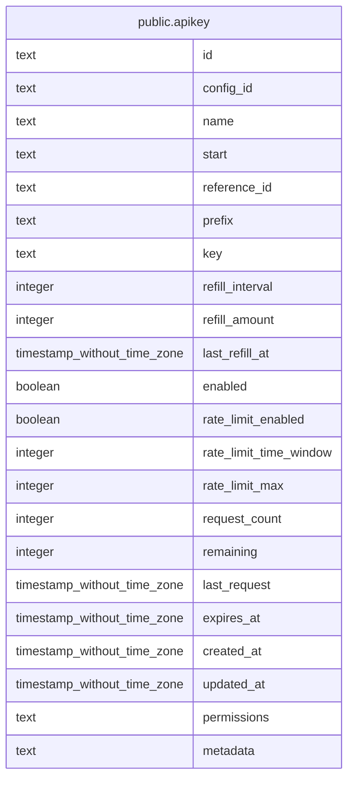

# public.apikey

## Description

Better Auth API key plugin が管理する API キー。

## Columns

| Name                   | Type                        | Default         | Nullable | Children | Parents | Comment                                             |
| ---------------------- | --------------------------- | --------------- | -------- | -------- | ------- | --------------------------------------------------- |
| id                     | text                        |                 | false    |          |         |                                                     |
| config_id              | text                        | 'default'::text | false    |          |         | API キーが属する設定の識別子。                      |
| name                   | text                        |                 | true     |          |         | API キーの名前。                                    |
| start                  | text                        |                 | true     |          |         | 画面で識別するために表示する API キーの先頭文字列。 |
| reference_id           | text                        |                 | false    |          |         | API キーを所有する対象の ID。                       |
| prefix                 | text                        |                 | true     |          |         | API キーの接頭辞。ハッシュ化せず保存する。          |
| key                    | text                        |                 | false    |          |         | API キーのハッシュ値。                              |
| refill_interval        | integer                     |                 | true     |          |         | 利用回数を補充する間隔。単位はミリ秒。              |
| refill_amount          | integer                     |                 | true     |          |         | 利用回数を補充するときに加算する回数。              |
| last_refill_at         | timestamp without time zone |                 | true     |          |         | 利用枠を最後に補充した時刻。                        |
| enabled                | boolean                     | true            | true     |          |         | API キーが有効かどうか。                            |
| rate_limit_enabled     | boolean                     | true            | true     |          |         | レート制限が有効かどうか。                          |
| rate_limit_time_window | integer                     | 86400000        | true     |          |         | レート制限を適用する時間幅。単位はミリ秒。          |
| rate_limit_max         | integer                     | 10              | true     |          |         | 時間幅内に許可する最大リクエスト数。                |
| request_count          | integer                     | 0               | true     |          |         | 時間幅内に記録されたリクエスト数。                  |
| remaining              | integer                     |                 | true     |          |         | 失効までの残り利用回数。null は回数制限なし。       |
| last_request           | timestamp without time zone |                 | true     |          |         | API キーが最後に使われた時刻。                      |
| expires_at             | timestamp without time zone |                 | true     |          |         | API キーの有効期限。                                |
| created_at             | timestamp without time zone |                 | false    |          |         |                                                     |
| updated_at             | timestamp without time zone |                 | false    |          |         |                                                     |
| permissions            | text                        |                 | true     |          |         | API キーに設定した権限。既定値は upload の create。 |
| metadata               | text                        |                 | true     |          |         | API キーに付けた追加情報。                          |

## Constraints

| Name                         | Type        | Definition            |
| ---------------------------- | ----------- | --------------------- |
| apikey_config_id_not_null    | n           | NOT NULL config_id    |
| apikey_created_at_not_null   | n           | NOT NULL created_at   |
| apikey_id_not_null           | n           | NOT NULL id           |
| apikey_key_not_null          | n           | NOT NULL key          |
| apikey_reference_id_not_null | n           | NOT NULL reference_id |
| apikey_updated_at_not_null   | n           | NOT NULL updated_at   |
| apikey_pkey                  | PRIMARY KEY | PRIMARY KEY (id)      |

## Indexes

| Name                   | Definition                                                                        |
| ---------------------- | --------------------------------------------------------------------------------- |
| apikey_pkey            | CREATE UNIQUE INDEX apikey_pkey ON public.apikey USING btree (id)                 |
| apikey_configId_idx    | CREATE INDEX "apikey_configId_idx" ON public.apikey USING btree (config_id)       |
| apikey_referenceId_idx | CREATE INDEX "apikey_referenceId_idx" ON public.apikey USING btree (reference_id) |
| apikey_key_idx         | CREATE INDEX apikey_key_idx ON public.apikey USING btree (key)                    |

## Relations

---

> Generated by [tbls](https://github.com/k1LoW/tbls)
