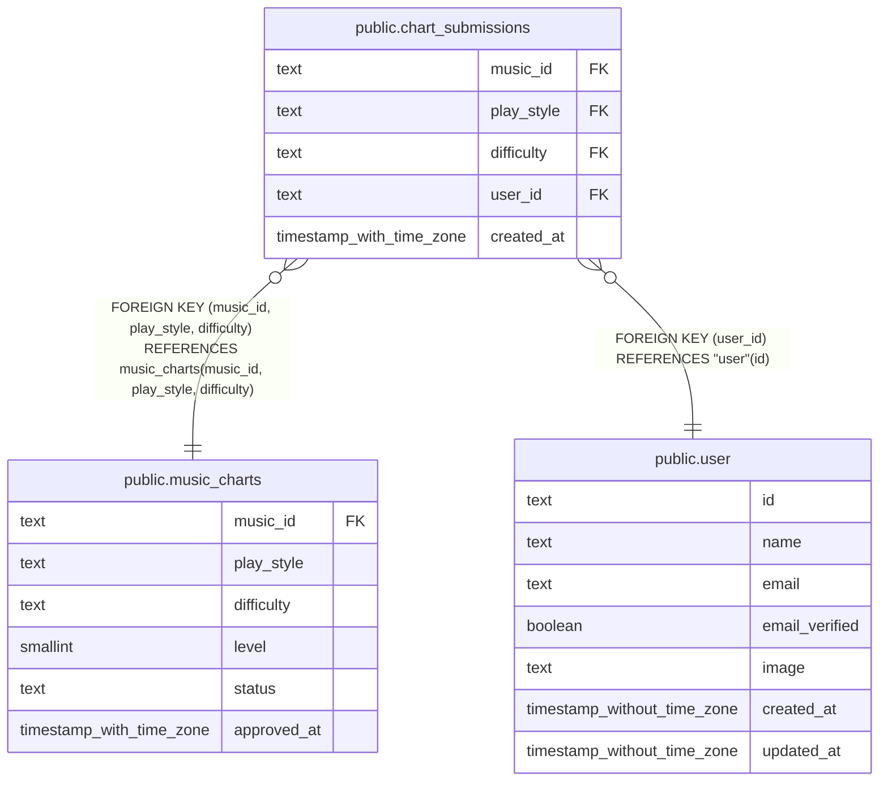

# public.chart_submissions

## Description

未承認の譜面に対するユーザーごとの登録記録。

## Columns

| Name       | Type                     | Default | Nullable | Children | Parents                                       | Comment                              |
| ---------- | ------------------------ | ------- | -------- | -------- | --------------------------------------------- | ------------------------------------ |
| music_id   | text                     |         | false    |          | [public.music_charts](public.music_charts.md) | 登録対象の楽曲。                     |
| play_style | text                     |         | false    |          | [public.music_charts](public.music_charts.md) | 譜面のプレイスタイル。sp または dp。 |
| difficulty | text                     |         | false    |          | [public.music_charts](public.music_charts.md) | 譜面の難易度。                       |
| user_id    | text                     |         | false    |          | [public.user](public.user.md)                 | 譜面を登録したユーザー。             |
| created_at | timestamp with time zone | now()   | false    |          |                                               |                                      |

## Constraints

| Name                                  | Type        | Definition                                                                                               |
| ------------------------------------- | ----------- | -------------------------------------------------------------------------------------------------------- |
| chart_submissions_created_at_not_null | n           | NOT NULL created_at                                                                                      |
| chart_submissions_difficulty_not_null | n           | NOT NULL difficulty                                                                                      |
| chart_submissions_music_id_not_null   | n           | NOT NULL music_id                                                                                        |
| chart_submissions_play_style_not_null | n           | NOT NULL play_style                                                                                      |
| chart_submissions_user_id_not_null    | n           | NOT NULL user_id                                                                                         |
| chart_submissions_user_id_fk          | FOREIGN KEY | FOREIGN KEY (user_id) REFERENCES "user"(id)                                                              |
| chart_submissions_pkey                | PRIMARY KEY | PRIMARY KEY (music_id, play_style, difficulty, user_id)                                                  |
| chart_submissions_chart_fk            | FOREIGN KEY | FOREIGN KEY (music_id, play_style, difficulty) REFERENCES music_charts(music_id, play_style, difficulty) |

## Indexes

| Name                   | Definition                                                                                                                     |
| ---------------------- | ------------------------------------------------------------------------------------------------------------------------------ |
| chart_submissions_pkey | CREATE UNIQUE INDEX chart_submissions_pkey ON public.chart_submissions USING btree (music_id, play_style, difficulty, user_id) |

## Relations

---

> Generated by [tbls](https://github.com/k1LoW/tbls)
