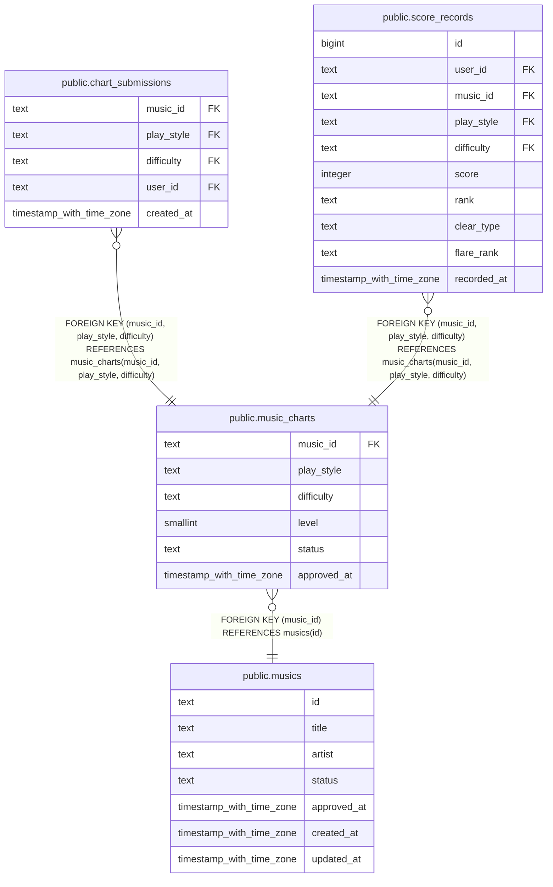

# public.music_charts

## Description

楽曲ごとのプレイスタイル・難易度別譜面と承認状態。

## Columns

| Name        | Type                     | Default | Nullable | Children                                                                                                | Parents                           | Comment                                     |
| ----------- | ------------------------ | ------- | -------- | ------------------------------------------------------------------------------------------------------- | --------------------------------- | ------------------------------------------- |
| music_id    | text                     |         | false    | [public.chart_submissions](public.chart_submissions.md) [public.score_records](public.score_records.md) | [public.musics](public.musics.md) | この譜面が属する楽曲。                      |
| play_style  | text                     |         | false    | [public.chart_submissions](public.chart_submissions.md) [public.score_records](public.score_records.md) |                                   | 譜面のプレイスタイル。sp または dp。        |
| difficulty  | text                     |         | false    | [public.chart_submissions](public.chart_submissions.md) [public.score_records](public.score_records.md) |                                   | 譜面の難易度。                              |
| level       | smallint                 |         | true     |                                                                                                         |                                   | 譜面のレベル。1 から 19 まで。              |
| status      | text                     |         | false    |                                                                                                         |                                   | 譜面の状態。pending または approved。       |
| approved_at | timestamp with time zone |         | true     |                                                                                                         |                                   | 譜面が承認された時刻。未承認の場合は null。 |

## Constraints

| Name                             | Type        | Definition                                                                                                                |
| -------------------------------- | ----------- | ------------------------------------------------------------------------------------------------------------------------- |
| music_charts_difficulty_not_null | n           | NOT NULL difficulty                                                                                                       |
| music_charts_difficulty_valid    | CHECK       | CHECK ((difficulty = ANY (ARRAY['beginner'::text, 'basic'::text, 'difficult'::text, 'expert'::text, 'challenge'::text]))) |
| music_charts_level_range         | CHECK       | CHECK (((level >= 1) AND (level <= 19)))                                                                                  |
| music_charts_music_id_not_null   | n           | NOT NULL music_id                                                                                                         |
| music_charts_play_style_not_null | n           | NOT NULL play_style                                                                                                       |
| music_charts_play_style_valid    | CHECK       | CHECK ((play_style = ANY (ARRAY['sp'::text, 'dp'::text])))                                                                |
| music_charts_status_not_null     | n           | NOT NULL status                                                                                                           |
| music_charts_status_valid        | CHECK       | CHECK ((status = ANY (ARRAY['pending'::text, 'approved'::text])))                                                         |
| music_charts_pkey                | PRIMARY KEY | PRIMARY KEY (music_id, play_style, difficulty)                                                                            |
| music_charts_music_id_fk         | FOREIGN KEY | FOREIGN KEY (music_id) REFERENCES musics(id)                                                                              |

## Indexes

| Name              | Definition                                                                                                  |
| ----------------- | ----------------------------------------------------------------------------------------------------------- |
| music_charts_pkey | CREATE UNIQUE INDEX music_charts_pkey ON public.music_charts USING btree (music_id, play_style, difficulty) |

## Relations

---

> Generated by [tbls](https://github.com/k1LoW/tbls)
