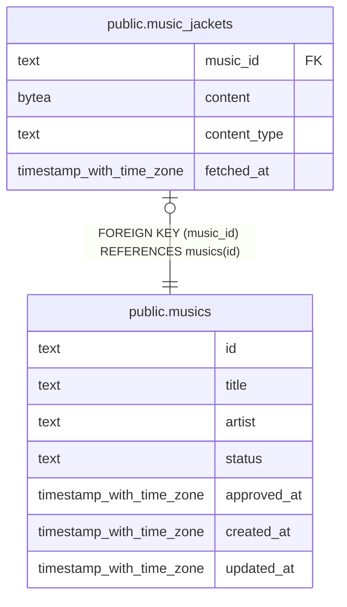

# public.music_jackets

## Description

楽曲に紐づくジャケット画像データ。

## Columns

| Name         | Type                     | Default | Nullable | Children | Parents                           | Comment                          |
| ------------ | ------------------------ | ------- | -------- | -------- | --------------------------------- | -------------------------------- |
| music_id     | text                     |         | false    |          | [public.musics](public.musics.md) | 画像が属する楽曲。               |
| content      | bytea                    |         | false    |          |                                   | ジャケット画像のバイナリデータ。 |
| content_type | text                     |         | false    |          |                                   | 画像データのメディアタイプ。     |
| fetched_at   | timestamp with time zone | now()   | false    |          |                                   | 画像データを取得した時刻。       |

## Constraints

| Name                                | Type        | Definition                                   |
| ----------------------------------- | ----------- | -------------------------------------------- |
| music_jackets_content_not_null      | n           | NOT NULL content                             |
| music_jackets_content_type_not_null | n           | NOT NULL content_type                        |
| music_jackets_fetched_at_not_null   | n           | NOT NULL fetched_at                          |
| music_jackets_music_id_not_null     | n           | NOT NULL music_id                            |
| music_jackets_pkey                  | PRIMARY KEY | PRIMARY KEY (music_id)                       |
| music_jackets_music_id_fk           | FOREIGN KEY | FOREIGN KEY (music_id) REFERENCES musics(id) |

## Indexes

| Name               | Definition                                                                            |
| ------------------ | ------------------------------------------------------------------------------------- |
| music_jackets_pkey | CREATE UNIQUE INDEX music_jackets_pkey ON public.music_jackets USING btree (music_id) |

## Relations

---

> Generated by [tbls](https://github.com/k1LoW/tbls)
