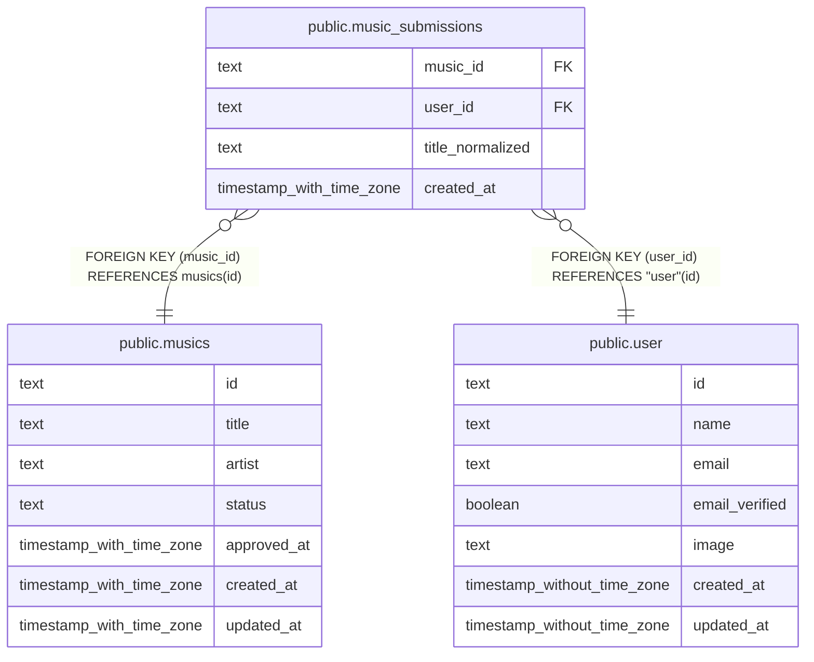

# public.music_submissions

## Description

楽曲ごとにユーザーが行った登録内容の記録。

## Columns

| Name             | Type                     | Default | Nullable | Children | Parents                           | Comment                                  |
| ---------------- | ------------------------ | ------- | -------- | -------- | --------------------------------- | ---------------------------------------- |
| music_id         | text                     |         | false    |          | [public.musics](public.musics.md) | 登録内容が属する楽曲。                   |
| user_id          | text                     |         | false    |          | [public.user](public.user.md)     | 楽曲を登録したユーザー。                 |
| title_normalized | text                     |         | false    |          |                                   | 登録時のタイトルを照合用に正規化した値。 |
| created_at       | timestamp with time zone | now()   | false    |          |                                   |                                          |

## Constraints

| Name                                        | Type        | Definition                                   |
| ------------------------------------------- | ----------- | -------------------------------------------- |
| music_submissions_created_at_not_null       | n           | NOT NULL created_at                          |
| music_submissions_music_id_not_null         | n           | NOT NULL music_id                            |
| music_submissions_title_normalized_not_null | n           | NOT NULL title_normalized                    |
| music_submissions_user_id_not_null          | n           | NOT NULL user_id                             |
| music_submissions_user_id_fk                | FOREIGN KEY | FOREIGN KEY (user_id) REFERENCES "user"(id)  |
| music_submissions_pkey                      | PRIMARY KEY | PRIMARY KEY (music_id, user_id)              |
| music_submissions_music_id_fk               | FOREIGN KEY | FOREIGN KEY (music_id) REFERENCES musics(id) |

## Indexes

| Name                   | Definition                                                                                             |
| ---------------------- | ------------------------------------------------------------------------------------------------------ |
| music_submissions_pkey | CREATE UNIQUE INDEX music_submissions_pkey ON public.music_submissions USING btree (music_id, user_id) |

## Relations

---

> Generated by [tbls](https://github.com/k1LoW/tbls)
