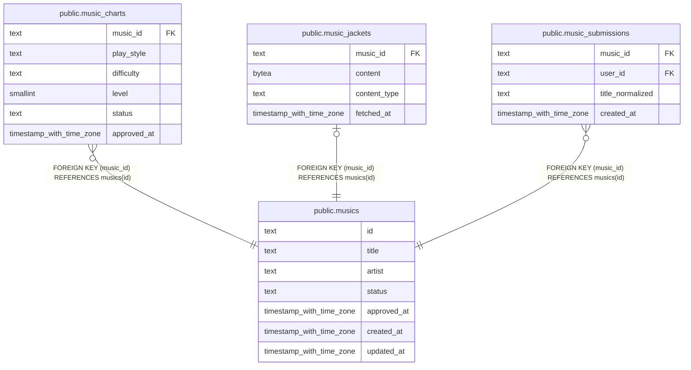

# public.musics

## Description

DDR 楽曲のカタログと承認状態。

## Columns

| Name        | Type                     | Default | Nullable | Children                                                                                                                                              | Parents | Comment                                     |
| ----------- | ------------------------ | ------- | -------- | ----------------------------------------------------------------------------------------------------------------------------------------------------- | ------- | ------------------------------------------- |
| id          | text                     |         | false    | [public.music_charts](public.music_charts.md) [public.music_jackets](public.music_jackets.md) [public.music_submissions](public.music_submissions.md) |         |                                             |
| title       | text                     |         | false    |                                                                                                                                                       |         | 楽曲のタイトル。                            |
| artist      | text                     |         | true     |                                                                                                                                                       |         | 楽曲のアーティスト名。                      |
| status      | text                     |         | false    |                                                                                                                                                       |         | 楽曲の状態。pending または approved。       |
| approved_at | timestamp with time zone |         | true     |                                                                                                                                                       |         | 楽曲が承認された時刻。未承認の場合は null。 |
| created_at  | timestamp with time zone | now()   | false    |                                                                                                                                                       |         |                                             |
| updated_at  | timestamp with time zone | now()   | false    |                                                                                                                                                       |         |                                             |

## Constraints

| Name                       | Type        | Definition                                                        |
| -------------------------- | ----------- | ----------------------------------------------------------------- |
| musics_created_at_not_null | n           | NOT NULL created_at                                               |
| musics_id_alnum            | CHECK       | CHECK ((id ~ '^[A-Za-z0-9]{1,64}$'::text))                        |
| musics_id_not_null         | n           | NOT NULL id                                                       |
| musics_status_not_null     | n           | NOT NULL status                                                   |
| musics_status_valid        | CHECK       | CHECK ((status = ANY (ARRAY['pending'::text, 'approved'::text]))) |
| musics_title_not_null      | n           | NOT NULL title                                                    |
| musics_updated_at_not_null | n           | NOT NULL updated_at                                               |
| musics_pkey                | PRIMARY KEY | PRIMARY KEY (id)                                                  |

## Indexes

| Name        | Definition                                                        |
| ----------- | ----------------------------------------------------------------- |
| musics_pkey | CREATE UNIQUE INDEX musics_pkey ON public.musics USING btree (id) |

## Relations

---

> Generated by [tbls](https://github.com/k1LoW/tbls)
