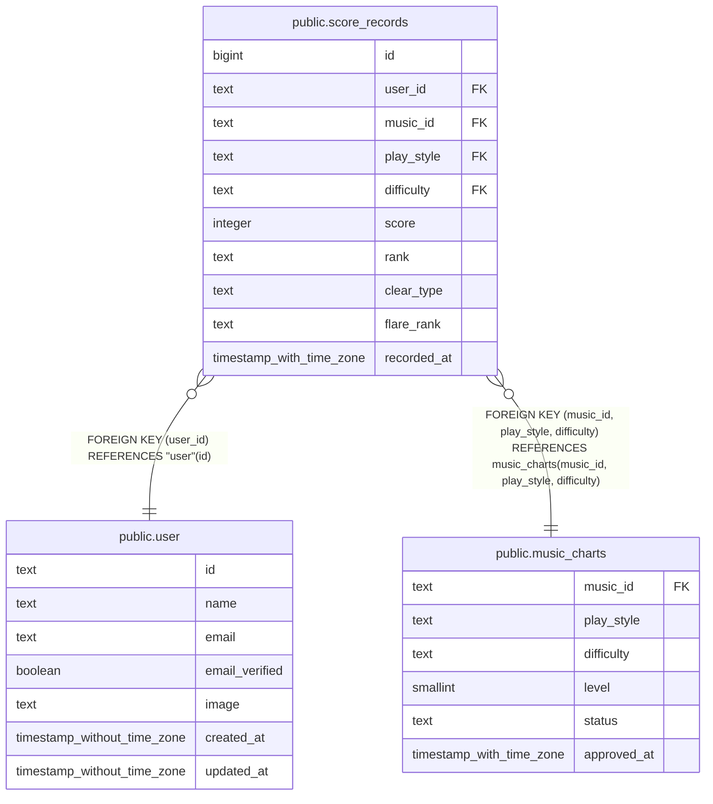

# public.score_records

## Description

ユーザーが登録した譜面ごとのスコア記録。

## Columns

| Name        | Type                     | Default | Nullable | Children | Parents                                       | Comment                                                        |
| ----------- | ------------------------ | ------- | -------- | -------- | --------------------------------------------- | -------------------------------------------------------------- |
| id          | bigint                   |         | false    |          |                                               |                                                                |
| user_id     | text                     |         | false    |          | [public.user](public.user.md)                 | スコアを記録したユーザー。                                     |
| music_id    | text                     |         | false    |          | [public.music_charts](public.music_charts.md) | スコア対象の楽曲。                                             |
| play_style  | text                     |         | false    |          | [public.music_charts](public.music_charts.md) | スコア対象譜面のプレイスタイル。                               |
| difficulty  | text                     |         | false    |          | [public.music_charts](public.music_charts.md) | スコア対象譜面の難易度。                                       |
| score       | integer                  |         | false    |          |                                               | 譜面のスコア。0 から 1,000,000 まで。                          |
| rank        | text                     |         | false    |          |                                               | スコア記録に含まれる DDR ランク値。                            |
| clear_type  | text                     |         | true     |          |                                               | スコア記録に含まれるクリア種別。未クリアは null。              |
| flare_rank  | text                     |         | true     |          |                                               | スコア記録に含まれるフレアランク。未設定は null。              |
| recorded_at | timestamp with time zone | now()   | false    |          |                                               | スコアレコードを作成した時刻。既定値はデータベースの現在時刻。 |

## Constraints

| Name                               | Type        | Definition                                                                                               |
| ---------------------------------- | ----------- | -------------------------------------------------------------------------------------------------------- |
| score_records_difficulty_not_null  | n           | NOT NULL difficulty                                                                                      |
| score_records_id_not_null          | n           | NOT NULL id                                                                                              |
| score_records_music_id_not_null    | n           | NOT NULL music_id                                                                                        |
| score_records_play_style_not_null  | n           | NOT NULL play_style                                                                                      |
| score_records_rank_not_null        | n           | NOT NULL rank                                                                                            |
| score_records_recorded_at_not_null | n           | NOT NULL recorded_at                                                                                     |
| score_records_score_not_null       | n           | NOT NULL score                                                                                           |
| score_records_score_range          | CHECK       | CHECK (((score >= 0) AND (score <= 1000000)))                                                            |
| score_records_user_id_not_null     | n           | NOT NULL user_id                                                                                         |
| score_records_user_id_fk           | FOREIGN KEY | FOREIGN KEY (user_id) REFERENCES "user"(id)                                                              |
| score_records_chart_fk             | FOREIGN KEY | FOREIGN KEY (music_id, play_style, difficulty) REFERENCES music_charts(music_id, play_style, difficulty) |
| score_records_pkey                 | PRIMARY KEY | PRIMARY KEY (id)                                                                                         |

## Indexes

| Name                     | Definition                                                                                                                                |
| ------------------------ | ----------------------------------------------------------------------------------------------------------------------------------------- |
| score_records_pkey       | CREATE UNIQUE INDEX score_records_pkey ON public.score_records USING btree (id)                                                           |
| score_records_lookup_idx | CREATE INDEX score_records_lookup_idx ON public.score_records USING btree (user_id, music_id, play_style, difficulty, id DESC NULLS LAST) |
| score_records_chart_idx  | CREATE INDEX score_records_chart_idx ON public.score_records USING btree (music_id, play_style, difficulty)                               |

## Relations

---

> Generated by [tbls](https://github.com/k1LoW/tbls)
