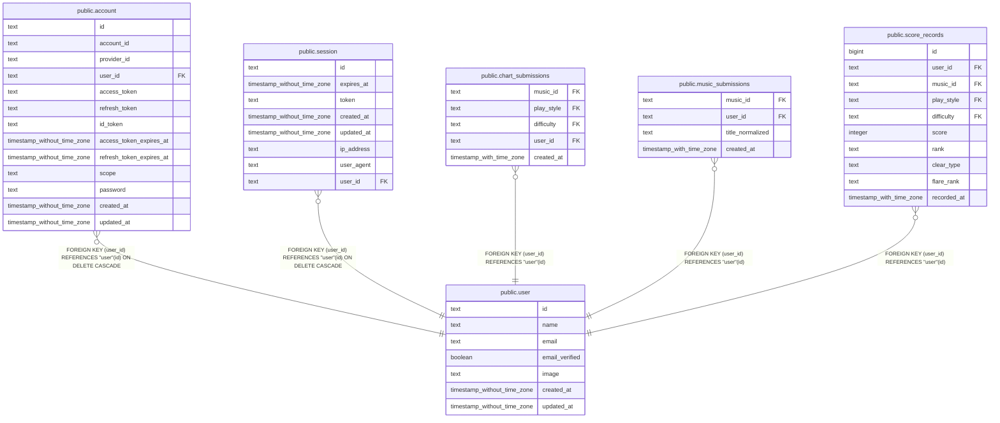

# public.user

## Description

Better Auth が管理する認証ユーザー。

## Columns

| Name           | Type                        | Default | Nullable | Children                                                                                                                                                                                                                                | Parents | Comment                            |
| -------------- | --------------------------- | ------- | -------- | --------------------------------------------------------------------------------------------------------------------------------------------------------------------------------------------------------------------------------------- | ------- | ---------------------------------- |
| id             | text                        |         | false    | [public.account](public.account.md) [public.session](public.session.md) [public.chart_submissions](public.chart_submissions.md) [public.music_submissions](public.music_submissions.md) [public.score_records](public.score_records.md) |         |                                    |
| name           | text                        |         | false    |                                                                                                                                                                                                                                         |         | ユーザー名。                       |
| email          | text                        |         | false    |                                                                                                                                                                                                                                         |         | ユーザーのメールアドレス。         |
| email_verified | boolean                     | false   | false    |                                                                                                                                                                                                                                         |         | メールアドレスが確認済みかどうか。 |
| image          | text                        |         | true     |                                                                                                                                                                                                                                         |         | ユーザー画像の URL。               |
| created_at     | timestamp without time zone | now()   | false    |                                                                                                                                                                                                                                         |         |                                    |
| updated_at     | timestamp without time zone | now()   | false    |                                                                                                                                                                                                                                         |         |                                    |

## Constraints

| Name                         | Type        | Definition              |
| ---------------------------- | ----------- | ----------------------- |
| user_created_at_not_null     | n           | NOT NULL created_at     |
| user_email_not_null          | n           | NOT NULL email          |
| user_email_verified_not_null | n           | NOT NULL email_verified |
| user_id_not_null             | n           | NOT NULL id             |
| user_name_not_null           | n           | NOT NULL name           |
| user_updated_at_not_null     | n           | NOT NULL updated_at     |
| user_pkey                    | PRIMARY KEY | PRIMARY KEY (id)        |
| user_email_unique            | UNIQUE      | UNIQUE (email)          |

## Indexes

| Name              | Definition                                                                 |
| ----------------- | -------------------------------------------------------------------------- |
| user_pkey         | CREATE UNIQUE INDEX user_pkey ON public."user" USING btree (id)            |
| user_email_unique | CREATE UNIQUE INDEX user_email_unique ON public."user" USING btree (email) |

## Relations

---

> Generated by [tbls](https://github.com/k1LoW/tbls)
